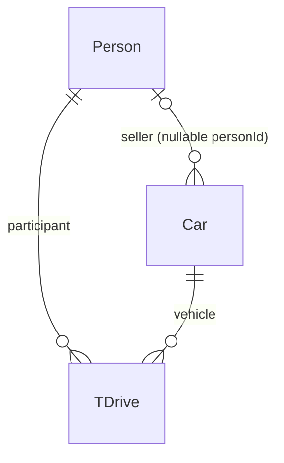

# A5_02_UsedCarsRoom3

## Purpose and prerequisites

**A5_02 builds on A5_01 and extends the single-table Room example with relationships.** The focus is a **1:N relationship between Person and Car** for sellers and a **many-to-many relationship between Person and Car through TDrive** for test drives.

Students should understand Room entities, primary keys, DAOs, SQL queries, DTO/Domain mapping, repositories, and the Koin database container from A5_01. Existing UI, navigation, effects, and image infrastructure provide the application context.

## Learning objectives

After studying the module, students should be able to:

- Model 1:N using a foreign key on the N side and distinguish seller from test-drive participant.
- Resolve an m:n relationship through an association entity with its own attributes.
- Explain foreign keys, indexes, uniqueness, nullability, and `ForeignKey.RESTRICT`.
- Read JOIN queries and interpret Room multimap results of type `Map<PersonDto, List<CarDto>>`.
- Explain how three tables and DAOs share one database through dependency injection.
- Verify that seller queries and test-drive queries follow different relationships.

## Relational model

### 1:N: seller and cars

`CarDto.personId` references `PersonDto.id`. One person can be the seller of several cars; a car references at most one seller. **The current column is nullable (`String?`)**, so the database also permits a car without an assigned seller. A non-null value must reference an existing person.

`CarDto` declares the foreign key and an index on `personId`. The seller relationship belongs to `Car`; no list of car IDs is stored in the Person row.

### m:n: people and cars through test drives

A person can test-drive several cars, and a car can be test-driven by several people. `TDriveDto` represents each test-drive event:

| Column | Role |
| --- | --- |
| `id` | Primary key identifying the test drive |
| `personId` | Required foreign key to the participant |
| `carId` | Required foreign key to the vehicle |
| `start` | Test-drive start time (`Instant`) |
| `isCompleted` | Completion status |

TDrive is an association entity with its own data. Its participant is independent of the car's seller. For example, Anna sells a Golf and a Passat; Clara test-drives the Golf. The Golf belongs to Anna's seller query and Clara's test-drive query.

A unique index on **`personId, carId, start`** prevents duplicate entries for that combination. The same person can test-drive the same car at different start times. Separate indexes support both foreign-key columns.

## Queries and integrity

| DAO operation | Relationship followed |
| --- | --- |
| `ICarDao.findByPersonId()` | Cars assigned to one seller |
| `IPersonDao.findByIdWithCars()` | JOIN Person → Car using `Car.personId` |
| `IPersonDao.findWithTestDriveCars()` | JOIN Person → TDrive → Car using participant and vehicle IDs |

The two Person DAO JOIN queries return `Map<PersonDto, List<CarDto>>`. They use INNER JOINs: a person without matching related records produces an empty map, rather than an entry with an empty list. The test-drive query returns cars, while TDrive's own attributes remain available through `ITDriveDao`.

All declared foreign keys use `RESTRICT`. A referenced person or car cannot simply be deleted while dependent records remain. Deletion order must respect both seller assignments and test drives. This is part of referential integrity, not only a UI validation rule.

## Database and DI container

`AppDatabase` registers `PersonDto`, `CarDto`, and `TDriveDto` and exposes `createPersonDao()`, `createCarDao()`, and `createTDriveDao()`. Column converters handle the car's image-path list and TDrive's `Instant`.

In `di/appModules.kt`, Koin registers one `single<AppDatabase>`, three DAO singletons obtained from that database, and three repository bindings. `get<AppDatabase>()` resolves the common database; constructor injection supplies each repository with its DAO. Domain entities and UI remain separate from annotated persistence models.

## Didactic approach and learning path

Keep seller assignment and test-drive participation distinct throughout:

1. **Draw the relationships:** Mark primary/foreign keys and identify the N side and the association entity.
2. **Build an example:** Assign two cars to one seller and a test drive to another person. Predict both Person DAO query results.
3. **Trace the JOINs:** Explain why `Car.personId` and `TDrive.personId` answer different questions.
4. **Discuss constraints:** Predict invalid foreign-key, duplicate test-drive, and restricted-delete outcomes. Distinguish the intended seller assignment from the nullable schema.
5. **Read relationship tests:** `UsedCarsRelationshipTest` exercises seller filtering and both multimap queries on an in-memory Room database. `RoomRelationsTest` explicitly separates seller and driver results.

As a learning outcome, provide an ER diagram, one sample dataset, and expected seller/test-drive query results. Relationships, JOINs, and integrity are the new focus; image handling and UI architecture support the example.

Source basis: [MobileSystems, revision 6e82a97](https://github.com/berndRog/MobileSystems/tree/6e82a973e40dfe863076ac227a70fca73396e8b4/A5_02_UsedCarsRoom3).
