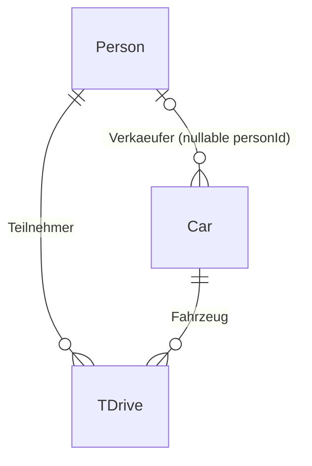

# A5_02_UsedCarsRoom3

## Zielsetzung und Voraussetzungen

**A5_02 baut auf A5_01 auf und erweitert das Room-Beispiel mit einer Tabelle um Beziehungen.** Im Mittelpunkt stehen eine **1:N-Beziehung zwischen Person und Car** für Verkäufer und eine **m:n-Beziehung zwischen Person und Car über TDrive** für Testfahrten.

Vorausgesetzt werden Room-Entities, Primary Keys, DAOs, SQL-Abfragen, DTO-/Domain-Mapping, Repositories und der Koin-Datenbankcontainer aus A5_01. Bestehende UI, Navigation, Effects und Bildinfrastruktur bilden den Anwendungsrahmen.

## Lernziele

Nach der Bearbeitung können Studierende:

- Eine 1:N-Beziehung mit Fremdschlüssel auf der N-Seite modellieren und Verkäufer von Testfahrtteilnehmern unterscheiden.
- Eine m:n-Beziehung durch eine Zuordnungs-Entity mit eigenen Attributen auflösen.
- Fremdschlüssel, Indizes, Eindeutigkeit, Nullability und `ForeignKey.RESTRICT` erklären.
- JOIN-Abfragen lesen und Room-Multimap-Ergebnisse vom Typ `Map<PersonDto, List<CarDto>>` interpretieren.
- Erklären, wie drei Tabellen und DAOs über Dependency Injection dieselbe Datenbank verwenden.
- Prüfen, dass Verkäufer- und Testfahrtabfragen unterschiedlichen Beziehungen folgen.

## Relationales Modell

### 1:N: Verkäufer und Fahrzeuge

`CarDto.personId` verweist auf `PersonDto.id`. Eine Person kann Verkäufer mehrerer Fahrzeuge sein; ein Fahrzeug verweist auf höchstens einen Verkäufer. **Die aktuelle Spalte ist nullable (`String?`)**; die Datenbank erlaubt deshalb auch ein Fahrzeug ohne zugeordneten Verkäufer. Ein gesetzter Wert muss auf eine vorhandene Person verweisen.

`CarDto` definiert den Fremdschlüssel und einen Index auf `personId`. Die Verkäuferzuordnung liegt in `Car`; in der Person-Zeile wird keine Liste von Fahrzeug-IDs gespeichert.

### m:n: Personen und Fahrzeuge über Testfahrten

Eine Person kann mehrere Fahrzeuge probefahren; ein Fahrzeug kann von mehreren Personen probegefahren werden. `TDriveDto` bildet jeweils eine konkrete Testfahrt ab:

| Spalte | Aufgabe |
| --- | --- |
| `id` | Primary Key zur Identifikation der Testfahrt |
| `personId` | Erforderlicher Fremdschlüssel zum Teilnehmer |
| `carId` | Erforderlicher Fremdschlüssel zum Fahrzeug |
| `start` | Beginn der Testfahrt (`Instant`) |
| `isCompleted` | Abschlussstatus |

TDrive ist eine Zuordnungs-Entity mit eigenen Daten. Ihr Teilnehmer ist unabhängig vom Verkäufer des Fahrzeugs. Beispiel: Anna verkauft einen Golf und einen Passat; Clara fährt den Golf probe. Der Golf erscheint in Annas Verkäuferabfrage und Claras Testfahrtabfrage.

Ein eindeutiger Index auf **`personId, carId, start`** verhindert doppelte Einträge dieser Kombination. Dieselbe Person kann dasselbe Fahrzeug zu unterschiedlichen Startzeitpunkten probefahren. Separate Indizes unterstützen beide Fremdschlüsselspalten.

## Abfragen und Integrität

| DAO-Operation | Verfolgte Beziehung |
| --- | --- |
| `ICarDao.findByPersonId()` | Fahrzeuge eines Verkäufers |
| `IPersonDao.findByIdWithCars()` | JOIN Person → Car über `Car.personId` |
| `IPersonDao.findWithTestDriveCars()` | JOIN Person → TDrive → Car über Teilnehmer- und Fahrzeug-ID |

Die beiden JOIN-Abfragen im Person-DAO liefern `Map<PersonDto, List<CarDto>>`. Es sind INNER JOINs: Ohne passende verknüpfte Datensätze entsteht eine leere Map statt eines Eintrags mit leerer Liste. Die Testfahrtabfrage liefert Fahrzeuge; die eigenen Attribute von TDrive sind über `ITDriveDao` verfügbar.

Alle definierten Fremdschlüssel verwenden `RESTRICT`. Eine referenzierte Person oder ein referenziertes Fahrzeug kann nicht einfach gelöscht werden, solange abhängige Datensätze bestehen. Die Löschreihenfolge muss Verkäuferzuordnungen und Testfahrten berücksichtigen. Das ist referenzielle Integrität und nicht lediglich eine UI-Validierungsregel.

## Datenbank und DI-Container

`AppDatabase` registriert `PersonDto`, `CarDto` und `TDriveDto` und stellt `createPersonDao()`, `createCarDao()` sowie `createTDriveDao()` bereit. Column Converter verarbeiten die Bildpfadliste des Fahrzeugs und den `Instant` von TDrive.

In `di/appModules.kt` registriert Koin eine `single<AppDatabase>`, drei daraus bezogene DAO-Singletons und drei Repository-Bindings. `get<AppDatabase>()` löst die gemeinsame Datenbank auf; Constructor Injection versorgt jedes Repository mit seinem DAO. Domain-Entities und UI bleiben von annotierten Persistenzmodellen getrennt.

## Didaktischer Ansatz und Lernpfad

Verkäuferzuordnung und Testfahrtteilnahme werden konsequent auseinandergehalten:

1. **Beziehungen zeichnen:** Primary-/Foreign-Keys markieren und N-Seite sowie Zuordnungs-Entity bestimmen.
2. **Beispiel aufbauen:** Zwei Fahrzeuge einem Verkäufer und eine Testfahrt einer anderen Person zuordnen. Ergebnisse beider Person-DAO-Abfragen vorhersagen.
3. **JOINs verfolgen:** Erklären, warum `Car.personId` und `TDrive.personId` unterschiedliche Fragen beantworten.
4. **Constraints diskutieren:** Ergebnisse bei ungültigen Fremdschlüsseln, doppelter Testfahrt und gesperrtem Löschen vorhersagen. Vorgesehene Verkäuferzuordnung und nullable Schema unterscheiden.
5. **Beziehungstests lesen:** `UsedCarsRelationshipTest` untersucht Verkäuferfilterung und beide Multimap-Abfragen mit einer In-Memory-Room-Datenbank. `RoomRelationsTest` trennt Verkäufer- und Fahrergebnisse ausdrücklich.

Als Lernnachweis eignen sich ER-Diagramm, Beispieldatenbestand und erwartete Ergebnisse der Verkäufer-/Testfahrtabfragen. Neu im Mittelpunkt stehen Beziehungen, JOINs und Integrität; Bildverwaltung und UI-Architektur unterstützen das Beispiel.

Quellcodebasis: [MobileSystems, Revision 6e82a97](https://github.com/berndRog/MobileSystems/tree/6e82a973e40dfe863076ac227a70fca73396e8b4/A5_02_UsedCarsRoom3).
